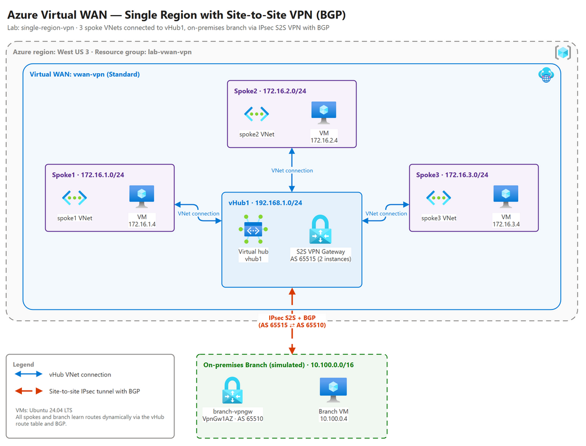

# Lab: Single region Virtual WAN Hub and S2S VPN to on-premises

## Intro

In this post, you can find a simple lab to demonstrate how to build a Virtual WAN Hub with a S2S VPN connection to on-premises (branch1) using a Virtual Network Gateway (VNG) and connecting over VPN to the vHub using IPSec S2S VPN with BGP.

## Diagram



## Deploy this solution

Use the following command to deploy this solution:

```bash
curl -s https://raw.githubusercontent.com/dmauser/azure-virtualwan/main/single-region-vpn/deploy.azcli | bash
```

Few notes:
1. Run it from Azure Cloud Shell Bash or Azure CLI for Linux. This script does not work over Azure CLI for Windows.

2. The script prompts for the VM admin username (default: **azureuser**) and password. The password must be 12-123 characters and include 3 of the following: lowercase, uppercase, digit, special character. To skip the prompts, export `username` and `password` before running the script.

3. All VMs are accessible using Serial Console or SSH. For SSH, ensure you adjust the existing NSG to access the target VM  from your remote Public IP.

4. The branch Virtual Network Gateways use the zone-redundant **VpnGw1AZ** SKU (Generation1) with a Standard SKU public IP. Non-AZ SKUs (VpnGw1-5) can no longer be created. For more information, see [VPN Gateway SKU consolidation and migration](https://learn.microsoft.com/azure/vpn-gateway/gateway-sku-consolidation).

## Optional add-ons

Run these scripts after `deploy.azcli` has finished. They reuse the same resource group (`lab-vwan-vpn`) and vHub.

| Script | Description |
|--------|-------------|
| [add-branch2.azcli](./add-branch2.azcli) | Adds a second branch (`branch2`, 10.200.0.0/16, ASN 65509) with its own VPN Gateway connected to the vHub over S2S VPN with BGP. Use it to validate branch-to-branch transit via the vHub. |
| [add-er.azcli](./add-er.azcli) | Adds an ExpressRoute Gateway to the vHub and an ExpressRoute circuit (Megaport, Washington DC). **Note:** circuit billing starts as soon as it's created, and the connection only completes after the circuit is provisioned by the service provider. |

```bash
curl -s https://raw.githubusercontent.com/dmauser/azure-virtualwan/main/single-region-vpn/add-branch2.azcli | bash
curl -s https://raw.githubusercontent.com/dmauser/azure-virtualwan/main/single-region-vpn/add-er.azcli | bash
```

## Validation

```bash
rg=lab-vwan-vpn
hubname=vhub1

# VPN connection status from the branch side
for conn in $(az network vpn-connection list -g $rg --query '[].name' -o tsv); do
    echo "$conn: $(az network vpn-connection show -g $rg -n $conn --query connectionStatus -o tsv)"
done

# vHub defaultRouteTable effective routes (branch prefixes should be learned via the VPN Gateway)
az network vhub get-effective-routes -g $rg -n $hubname --resource-type RouteTable \
 --resource-id $(az network vhub route-table show --name defaultRouteTable --vhub-name $hubname -g $rg --query id -o tsv) \
 --query 'value[].{prefix:addressPrefixes[0],asPath:asPath,nextHopType:nextHopType}' -o table

# Spoke VM effective routes (branch 10.100.0.0/16 should point to the vHub)
az network nic show-effective-route-table -g $rg -n spoke1VMVMNic -o table

# Routes learned by the branch VPN Gateway (spokes 172.16.x.0/24 via the vHub)
az network vnet-gateway list-learned-routes -g $rg -n branch-vpngw -o table
```

- [bgpinfo.azcli](./bgpinfo.azcli) shows BGP peer status (state, ASN, routes received/advertised) for the vHub VPN Gateway and the branch VPN Gateways.
- [misc.azcli](./misc.azcli) contains additional troubleshooting commands.
- From `branchVM`, ping or traceroute the spoke VMs (172.16.1.4, 172.16.2.4, 172.16.3.4) to confirm connectivity.

## Clean up

```bash
az group delete -n lab-vwan-vpn --yes --no-wait
```